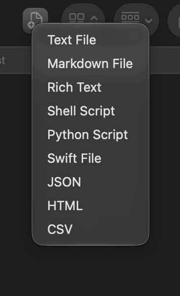

# New File Maker

A Finder toolbar button for making new files. Click it, pick a file type, and you get an empty `Untitled` file in whatever folder you're looking at.



The menu offers Text, Markdown, Rich Text, Shell Script, Python, Swift, JSON, HTML and CSV. The new file lands in the folder open in the front Finder window, and Finder selects it so you can rename it straight away. If `Untitled.txt` already exists you get `Untitled 2.txt`, and so on. Shell scripts start with a `#!/bin/zsh` line and are already executable.

## Install

You need the Xcode command line tools for `swiftc`. Build the app:

```sh
./build.sh
```

Copy `NewFileMaker.app` to `/Applications`, then hold ⌘ and drag it into the Finder toolbar. It will now show up in every Finder window.

The first time you use it, macOS asks whether New File Maker may control Finder. Say yes, since that's how it finds out which folder you're in.
