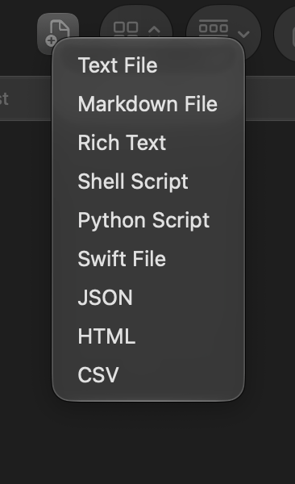

# New File Maker

A Finder toolbar button for making new files. Click it, pick a file type, and you get an empty `Untitled` file in whatever folder you're looking at.



The menu offers Text, Markdown, Rich Text, Shell Script, Python, Swift, JSON, HTML, CSV and Pages. The new file lands in the folder open in the front Finder window, and Finder selects it so you can rename it straight away. If `Untitled.txt` already exists you get `Untitled 2.txt`, and so on. Shell scripts start with a `#!/bin/zsh` line and are already executable. Pages files are blank documents.

To add your own files to the menu, choose **Open Templates Folder** and drop them in (`~/Library/Application Support/NewFileMaker/Templates`): picking one copies it, so `Invoice.numbers` gives `Invoice.numbers`, then `Invoice 2.numbers`.

Select emails in Mail, click the button and choose **Save Mail Selection as PDF** to get one PDF per email, named after its subject, in that folder. The option shows only while Mail is open.

With Alfred, press ⌃Space: in Finder it opens the menu, in Mail it saves the selected emails as PDFs straight into the folder open in Finder.

Right-click any files or folders in Finder and choose **Copy Full Path** to put their paths on the clipboard, one per line.

## Install

You need the Xcode command line tools for `swiftc`. Build the app:

```sh
./build.sh
```

Copy `NewFileMaker.app` to `/Applications`, then hold ⌘ and drag it into the Finder toolbar. It will now show up in every Finder window. Double-click `NewFileMaker.alfredworkflow` to add the ⌃Space hotkey to Alfred.

The first time you use it, macOS asks whether New File Maker may control Finder. Say yes, since that's how it finds out which folder you're in. It asks the same about Mail the first time you save emails as PDFs.
